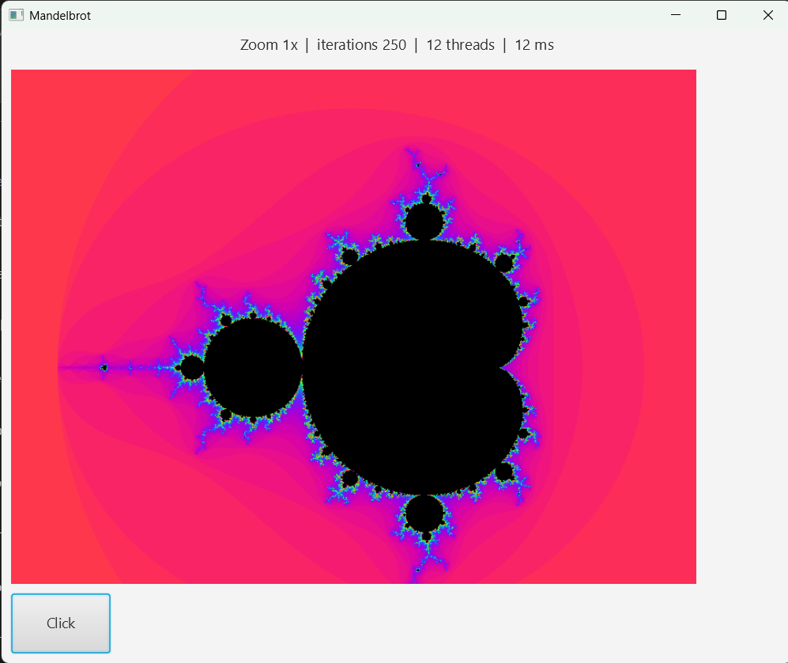
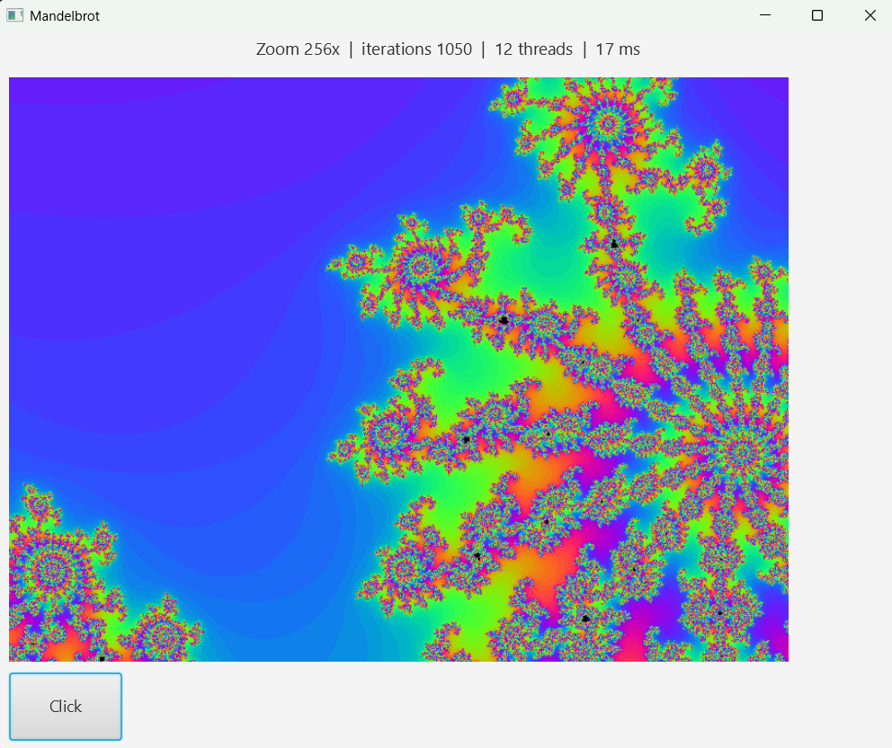

# Mandelbrot

A multi-threaded Mandelbrot set viewer written in [B4J](https://www.b4x.com/b4j.html) (JavaFX), using the B4XPages framework.



## Features

- Click to zoom in, right-click to zoom out, centred on the point you clicked
- Rendering is spread across all available CPU cores, with interleaved rows so each thread gets a similar workload
- A new click cancels any render in progress and restarts straight away
- Iteration count rises automatically with zoom depth to keep detail sharp
- Smooth rainbow palette; points inside the set are drawn black
- Status line shows zoom level, iteration count, thread count and render time
- Reset button returns to the full view



## Controls

| Action | Effect |
| --- | --- |
| Left click | Zoom in 2x, centred on the click |
| Right click | Zoom out 2x, centred on the click |
| Click button | Reset to the default view |

## Building and running

1. Install [B4J](https://www.b4x.com/b4j.html) (v10.7 or later) and a JDK compatible with it.
2. Open `B4J/Mandlebrot.b4j` in the B4J IDE.
3. Make sure the libraries `b4xpages`, `jcore`, `jfx` and `threading` are available (the first three ship with B4J as standard).
4. Press **F5** to run, or compile a standalone jar via *Project > Compile to Library/Jar*.

## How it works

- The 800x600 image maps onto the complex plane at `3.5 / 800` units per pixel at 1x zoom, centred on `-0.5 + 0i`.
- Each worker thread runs the standard escape-time iteration (`z = z² + c`) for its share of rows, writing iteration counts into a shared array.
- On completion the GUI thread colours the pixels from a 256-entry cosine palette and pushes them into a JavaFX `WritableImage` in a single call.
- Iterations scale as `250 + 100 * log2(zoom)`, capped at 10,000.
- Zoom stops at a scale of `1e-14`, where `Double` precision breaks down.

## Project layout

```
B4XMainPage.bas      Main page: rendering, threading and input handling (shared B4X code)
B4J/Mandlebrot.b4j   B4J project file
B4J/Files/           Designer layout (MainPage.bjl)
screenshots/         Images used in this README
```
